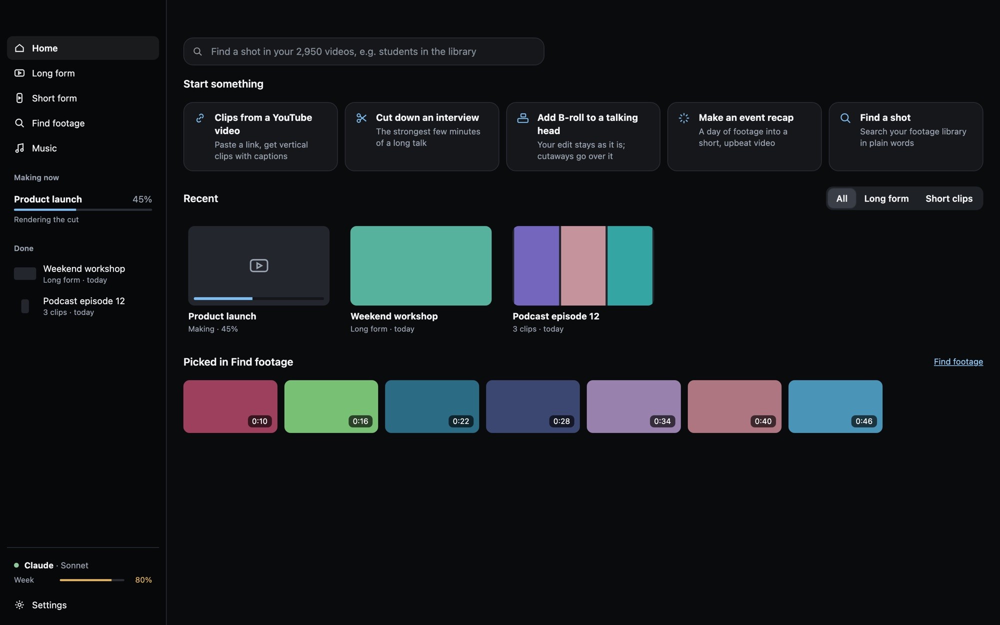
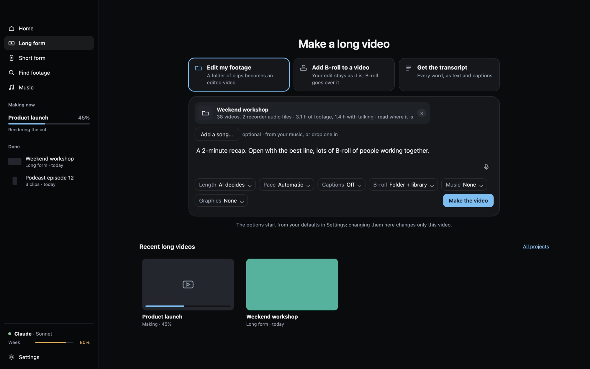
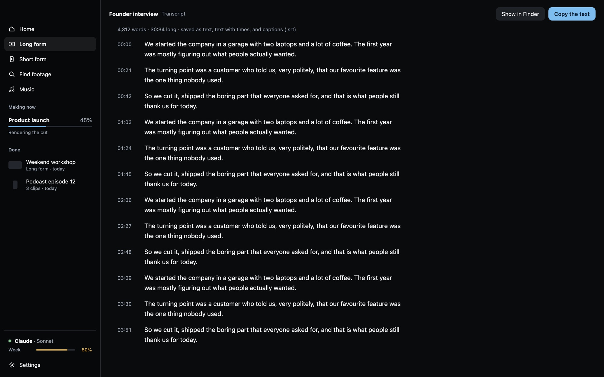
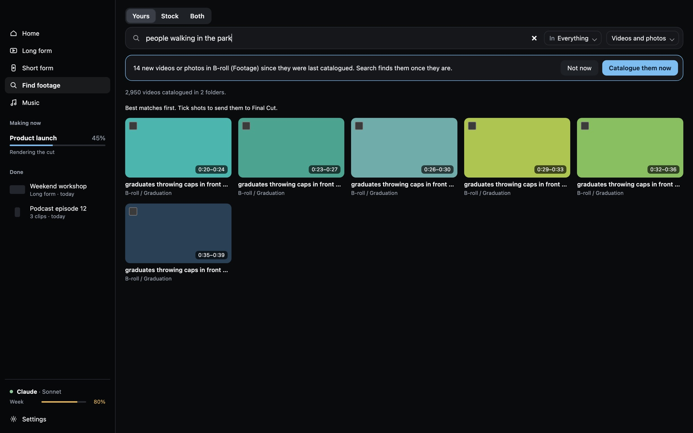
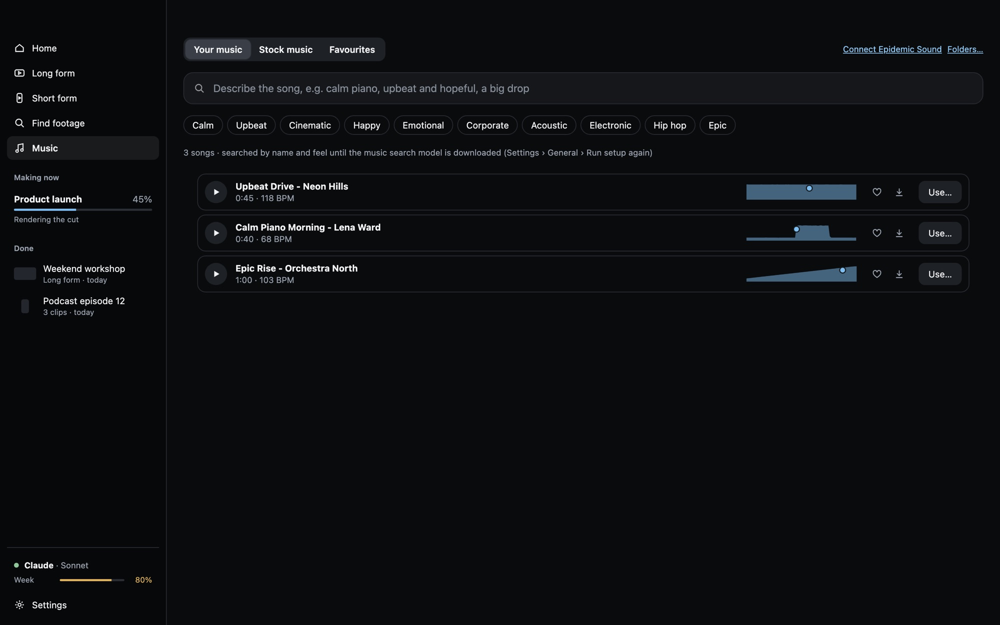
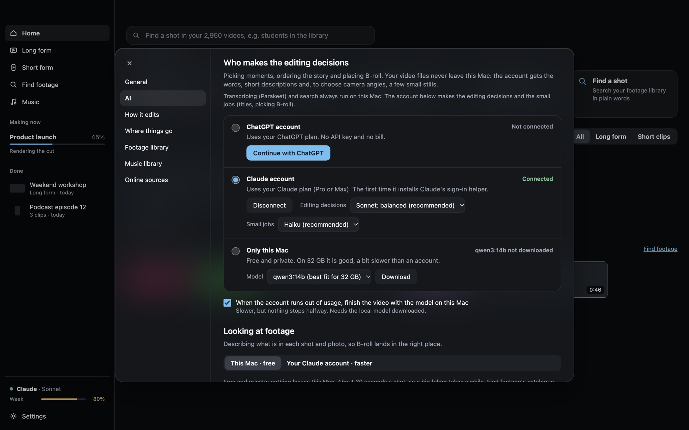

# FirstCut

> **Work in progress.** FirstCut is early and changes often. Expect rough edges, and keep your original footage backed up (FirstCut reads your footage where it is and never changes it, but it is still young software). Feedback and bug reports are welcome in [Issues](../../issues).

A Mac app that does the first cut of your video for you. Give it footage, say what you want, press one button.

## What it does

**Long form.** Point it at a folder of clips (an interview, an event, a talk) and say what you want, for example "a 2-minute recap, open with the best line". It writes down every word, finds the best moments, puts them in order, and covers the cuts with B-roll and photos from the folder or your footage library. Music, captions and graphics are there if you want them. It also syncs separate sound recorders and picks camera angles when you filmed with more than one camera. Already edited the video yourself? **Add B-roll to a video** keeps your edit exactly as it is and only puts B-roll over it.

**Short clips.** Drop in a long video or paste a link and get vertical clips with captions, ready to post.

**Get the transcript.** Every word of a video or recording, as plain text, text with times, and captions (.srt). It runs entirely on your Mac.

**Find footage.** Search all your footage in plain words ("people walking in the park"), see the best moment in each shot, and send picks straight to a new video or to Final Cut.

**Music.** Search your own music by describing it, or browse free stock music.

**Finish it yourself.** Every edit comes with a project for **Final Cut Pro** or **DaVinci Resolve**, so the first cut is a starting point, not a locked file.

**Your choice of AI.** The editing decisions are made by your **ChatGPT** account, your **Claude** account, or **a model on your Mac** (free and private, slower). Pace, length, captions, B-roll, music and graphics are one click each.

## Download

**[Download the latest FirstCut.dmg](../../releases/latest)**

Needs a Mac with Apple silicon (M1 or newer) and macOS 13 or later.

## Install

1. Open `FirstCut.dmg` and drag **FirstCut** onto **Applications**.
2. Open FirstCut. It is signed and notarized by Apple, so macOS only asks once whether you want to open an app you downloaded: click **Open**.
3. Setup gets it ready. It downloads the speech-to-text model and, if you want, a model that runs on your Mac. It shows the size first: about 6 GB on an 8 GB Mac, 10 GB on 16 GB.
4. Choose who makes the editing decisions: your ChatGPT account, your Claude account, or only this Mac.
5. The first time it opens footage on an external drive, or in Desktop, Documents or Downloads, macOS asks whether FirstCut may use those files. Click **Allow**.

## Privacy

Your video files never leave your Mac, and speech to text runs on your Mac. If you connect an AI account, it gets the words, short descriptions, and a few small stills when choosing camera angles. Describing your footage stays on your Mac unless you change that in Settings › AI.

It works offline too. With the model on your Mac downloaded, it keeps editing without the internet, and transcripts work offline once Setup has run.

## Remove it

Delete FirstCut from Applications, then delete `~/Library/Application Support/FirstCut` and the models folder you chose in Setup.

Screenshots use sample projects and placeholder thumbnails.
